# blender-shorts-agent

**Tell Claude Code what you want explained. Get back a finished, narrated vertical short made entirely in Blender.**

A Claude Code plugin that takes one idea ("why does a bike wheel tick when you coast?") to a ready-to-post 1080×1920
MP4 for YouTube Shorts, Reels or TikTok: the story, a real 3D scene built from code, narration, captions, recorded
sound effects, a checked render, and the title, description and hashtags. You approve the story and the storyboard
on clean HTML pages; after that it runs to the end on its own, and it checks its own work at every step.

<table>
<tr>
<td align="center" width="33%"><a href="https://www.youtube.com/shorts/CiJkurEFW2g">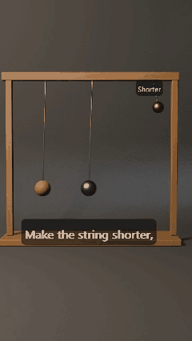</a><br><b>Heavy or light pendulum</b><br><a href="https://www.youtube.com/shorts/CiJkurEFW2g">Watch</a> · <a href="https://goinsidemachines.com/everyday/heavy-or-light-pendulum/">Read</a></td>
<td align="center" width="33%"><a href="https://www.youtube.com/shorts/0kTD73urxJA">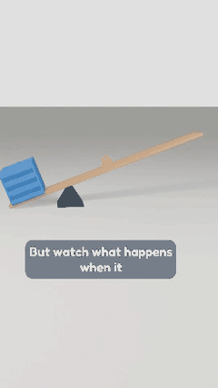</a><br><b>The lever</b><br><a href="https://www.youtube.com/shorts/0kTD73urxJA">Watch</a> · <a href="https://goinsidemachines.com/machines/the-lever/">Read</a></td>
<td align="center" width="33%"><a href="https://www.youtube.com/shorts/PZWokxHSg_0">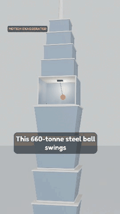</a><br><b>The Taipei 101 damper</b><br><a href="https://www.youtube.com/shorts/PZWokxHSg_0">Watch</a> · <a href="https://goinsidemachines.com/machines/the-taipei-101-damper/">Read</a></td>
</tr>
<tr>
<td align="center"><a href="https://www.youtube.com/shorts/RdU5MHgl2D0">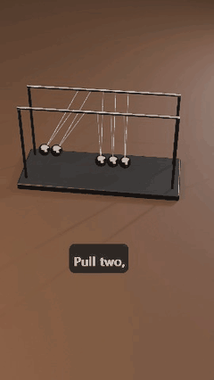</a><br><b>Newton's cradle</b><br><a href="https://www.youtube.com/shorts/RdU5MHgl2D0">Watch</a> · <a href="https://goinsidemachines.com/everyday/newtons-cradle/">Read</a></td>
<td align="center"><a href="https://www.youtube.com/shorts/MSxdoT709Mg">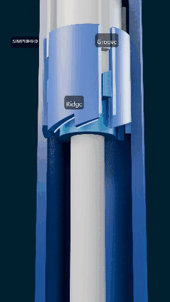</a><br><b>The click pen</b><br><a href="https://www.youtube.com/shorts/MSxdoT709Mg">Watch</a> · <a href="https://goinsidemachines.com/everyday/click-pen/">Read</a></td>
<td align="center"><a href="https://www.youtube.com/shorts/1Hg8j9ubPZA">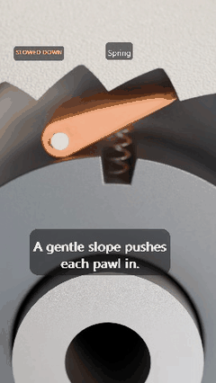</a><br><b>Why a bike wheel ticks</b><br><a href="https://www.youtube.com/shorts/1Hg8j9ubPZA">Watch</a> · <a href="https://goinsidemachines.com/everyday/bike-wheel-ticks/">Read</a></td>
</tr>
</table>

<sub>Every short above was made by this plugin, end to end, with no hand editing: story, models, animation, voice,
captions, sound and edit. Click one to watch it with sound.</sub>

---

## What you get

- **A finished MP4**, 1080×1920 at 30 fps, with narration, captions timed to it, recorded sound effects and your own
  end card. No music, ever.
- **Post text** ready to copy: title, description with sources, and hashtags.
- **Approval pages** instead of chat walls: you see the story, the storyboard pictures and the final video on HTML
  pages and answer in chat.
- **A real Blender project** you can open: `blend/short.blend`, built by a `build.py` you can read and change.
- **Checks you can trust**: the scene, the motion and every rendered frame are checked before you see anything.

## How it works

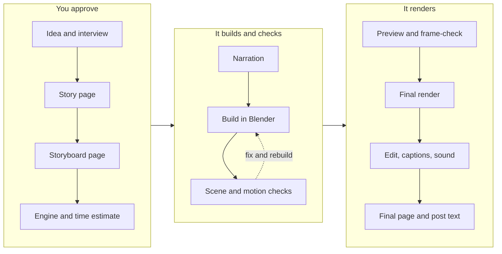

You talk to Claude Code as usual ("make a short about how a click pen clicks"). The `make-short` skill follows a
playbook chapter for every stage, tracks where each short stands, and picks up where it left off if you come back
tomorrow ("carry on with the pen short").

### 1. The story, on a page

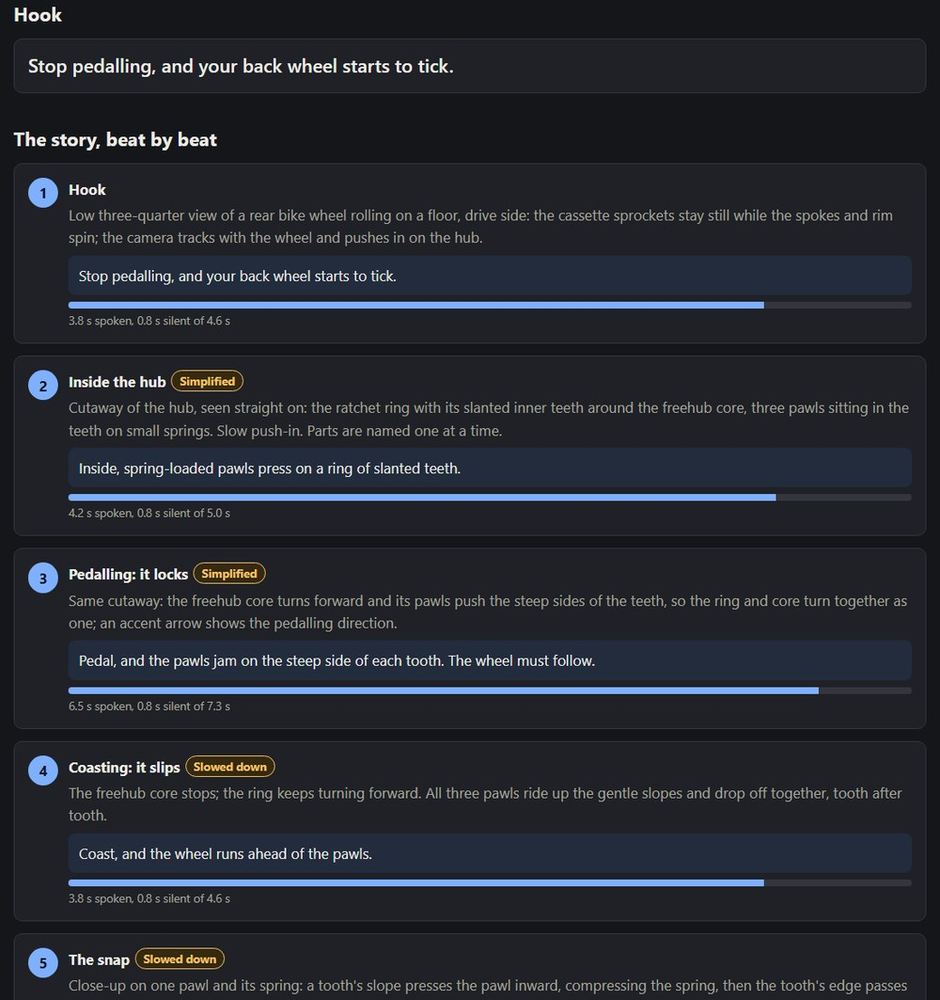

The hook, every beat with its narration line, how long each line takes to say, honesty badges ("Simplified", "Slowed
down") wherever the picture bends reality, and how this short keeps each of your hard rules.

### 2. The storyboard, with real stills

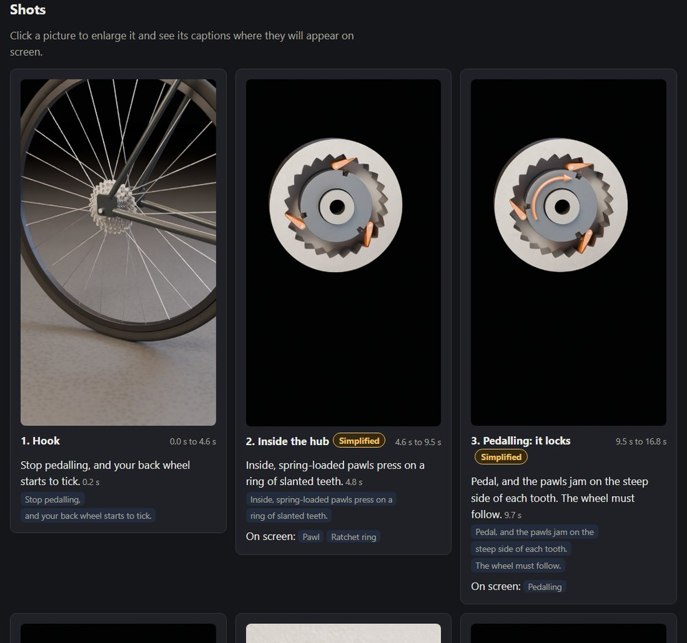

Each shot is built and rendered as a still before anything is animated, so you approve real pictures, not
descriptions. Click a still to see it with its captions where they will sit on screen.

### 3. It renders, and you can watch it happen

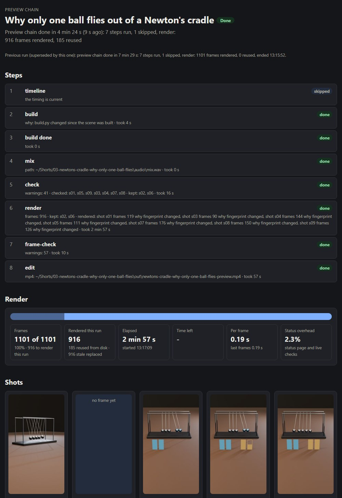

A live page shows the whole chain (timeline, build, mix, check, render, frame-check, edit): the current step, frames
done, time left, per-shot thumbnails and any warning as it appears. Only shots whose content changed render again,
so a fix to one shot doesn't cost you the whole video.

### 4. The final page

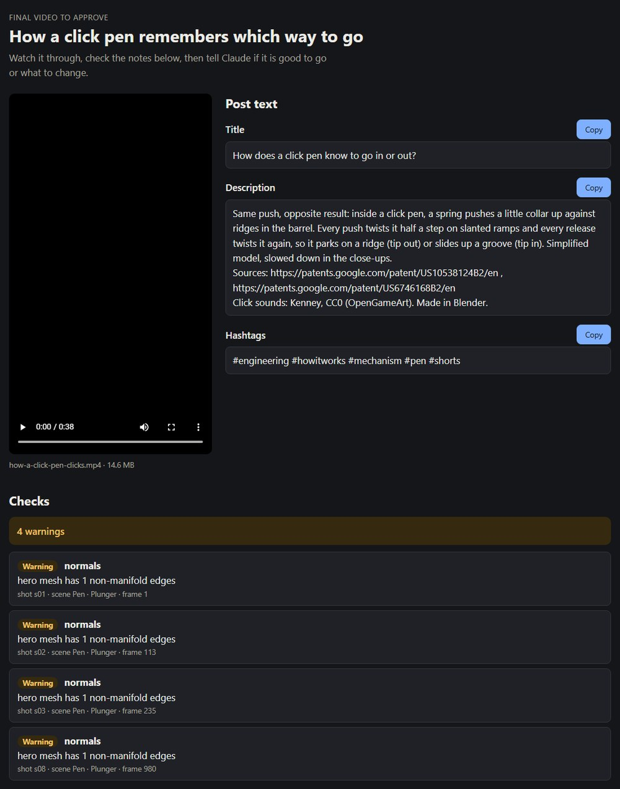

The video, the post text with copy buttons, every check that is left, and your hard rules one last time.

## Checks that catch what you'd miss

Explainer animation fails in small ways: a rod that passes through a bearing, a ball that floats a millimetre above
its cradle, two faces that flicker, a part that teleports for one frame. The plugin looks for all of it, on every
frame, before you see the video.

| In the scene | In the motion | In the rendered frames |
|---|---|---|
| Missing textures (pink), missing materials (grey) | Parts passing through each other, with depth and frames | Fireflies and noise |
| Flipped or inside-out normals, faceted curves | Pops: a part that jumps in one frame | Flicker between frames |
| Z-fighting faces, scaled to what the camera can see | Floating or sinking objects | Frames stuck when they should move |
| Live Booleans that can render differently | Heroes leaving the frame | Black frames |
| Names, tags and labels that point at the wrong object | Contact pairs whose parents drift apart | Colours off the planned look |

Every finding says what is wrong, where (object, shot, frame, position) and how to fix it, and the agent fixes it
itself and checks again. Single bad frames can be re-rendered on their own.

**Extremes.** Before the preview, each moving part is rendered at full size at the ends of its motion, where things
usually collide:

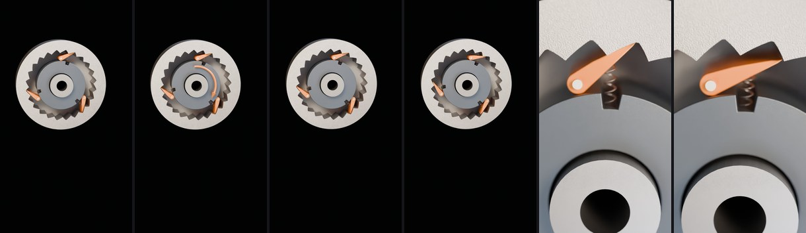

## Your hard rules

The first time you use it, the plugin asks for your own content rules, the things every video must keep whatever
the topic. For example: "No people on screen. No brand logos. Keep it family friendly." A broad rule can be spelled out in parts
in your own words. The rules are:

- shown on the story, storyboard and final pages, with how this short keeps each one;
- checked in the scene where they can be (object, material and model names), and in the sound (recorded sounds
  only, when you ask for that);
- never reinterpreted: if a request conflicts with one, the agent says so and asks.

You can add or change a rule any time, in plain words:

```
Add a hard rule: no humans, no people, body parts, faces, silhouettes or stick figures.
```

## Sound, voice and look

- **Narration** with a free local voice (Kokoro, Chatterbox or Chatterbox Turbo, installed only after you approve
  a list of what downloads, its licence and size), ElevenLabs with your own key, or **your own voice tool** through
  one command. Any voice problem means captions only, and the short goes on.
- **Sound effects** from recorded CC0 packs (OpenGameArt, Kenney, Wikimedia Commons, Freesound with a key), placed
  on the moments your simulation reports. Designed UI sounds are kept out of a natural-sounds-only mix.
- **Captions** timed to the narration, kept clear of the platform's buttons, and checked for missing glyphs.
- **Your brand or a fresh look per short**: your colours, fonts, handle and end card, or a new style chosen on the
  story page.
- **Honesty**: every number on screen or in the narration has a source; exaggerated or slowed motion carries a badge;
  myths are cut.

## Built for real machines

The playbook has a physics chapter and helpers for mechanisms, structures, forces and motion: pendulums, contact
chains (Newton's cradle), ratchets, levers, dampers. Motion is solved or simulated and baked, not keyframed by eye, so
the balls in the cradle trade momentum the way real ones do.

## Install

You need [Claude Code](https://claude.com/claude-code) and [Blender](https://www.blender.org/download/) 4.5 or newer.
An NVIDIA GPU makes Cycles and the local voices much faster, but EEVEE and Kokoro run on any computer.

In Claude Code:

```
/plugin marketplace add goinsidemachines/blender-shorts-agent
/plugin install blender-shorts-agent@blender-shorts-agent
```

Then just ask:

```
Make a short about why a bike wheel ticks when you stop pedalling.
```

The first run asks a few questions (where to save shorts, which voice, your render preference, brand or fresh look,
your hard rules, your handle) and remembers the answers.

**Script mode or MCP mode.** By default the plugin drives Blender in the background from the command line. If you
use the [Blender MCP](docs/mcp-setup.md) add-on, it can build in your open Blender instead, so you watch the scene
come together.

## What it runs and connects to

Everything runs on your own computer. The plugin sends no telemetry and has no server of its own.

- **What it runs:** Python scripts in this repository, with Blender in the background (or your open Blender through
  the Blender MCP add-on), and your own voice command if you set one.
- **What it fetches, only after you approve a list of what, from where, its licence and its size:** sound effects
  from OpenGameArt, Wikimedia Commons and Freesound (with your own Freesound key); textures, HDRIs and models from
  Poly Haven; fonts from Google Fonts; and, for the optional local voices, model weights from Hugging Face and Python
  packages through [uv](https://docs.astral.sh/uv/).
- **What it sends:** search words to those asset sources, and, only if you choose ElevenLabs for narration, your
  narration lines to ElevenLabs with your own API key.
- **What it keeps:** your settings in `~/.blender-shorts-agent/` (workspace, voice, hard rules, handle) and each
  short in its own folder in your workspace. Nothing leaves your machine besides the requests above.

## Under the hood

- `skills/make-short/`: the skill and its playbook, one chapter per stage, plus craft, honesty, sound, look and
  physics chapters.
- `bsa/`: the Python package that runs inside Blender's own Python (standard library and numpy only): scene helpers,
  checks, timeline, captions, audio mix, review pages.
- `bsa_cli.py` (plain Python) and `bsa_blender.py` (inside Blender): the commands the agent runs. Each prints one
  JSON result.
- `voices/`: the optional local voice runner.

```
uv run pytest        # 660+ tests, including Blender scene tests
uv run ruff check .
```

## Licence

MIT. Sound packs, fonts, textures and voices the plugin downloads keep their own licences, which are shown before
anything is downloaded.
