# blender-shorts-agent

[](https://github.com/goinsidemachines/blender-shorts-agent/actions/workflows/ci.yml)
[](https://github.com/goinsidemachines/blender-shorts-agent/releases)
[](LICENSE)
[](https://code.claude.com/docs/en/plugins)
[](https://www.blender.org/download/)

**Tell Claude Code what you want explained. Get back a finished, narrated vertical short made entirely in Blender.**

A Claude Code plugin that takes one idea ("why does a bike wheel tick when you coast?") to a ready-to-post 1080×1920
MP4 for YouTube Shorts, Reels or TikTok: the story, a real 3D scene built from code, narration, captions, recorded
sound effects, a checked render, a thumbnail, caption files and the post text. You follow and approve every stage on
one page in your browser; between approvals it runs on its own, and it checks its own work at every step.

<table>
<tr>
<td align="center" width="33%"><a href="https://www.youtube.com/shorts/sxrs0NHUBh8">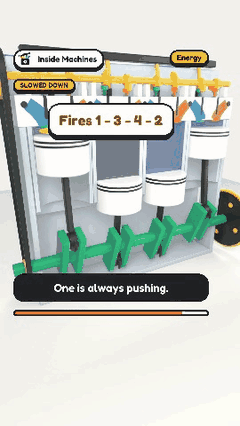</a><br><b>Inside a car engine</b><br><a href="https://www.youtube.com/shorts/sxrs0NHUBh8">Watch</a> · <a href="https://goinsidemachines.com/everyday/car-engine/">Read</a></td>
<td align="center" width="33%"><a href="https://www.youtube.com/shorts/98EPe6p-uas">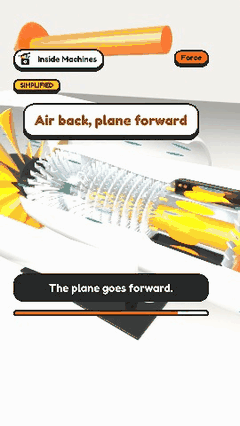</a><br><b>Inside a jet engine</b><br><a href="https://www.youtube.com/shorts/98EPe6p-uas">Watch</a> · <a href="https://goinsidemachines.com/everyday/jet-engine/">Read</a></td>
<td align="center" width="33%"><a href="https://www.youtube.com/shorts/tb6BCOTsYPY">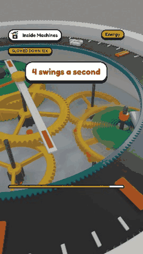</a><br><b>Inside a mechanical watch</b><br><a href="https://www.youtube.com/shorts/tb6BCOTsYPY">Watch</a> · <a href="https://goinsidemachines.com/everyday/mechanical-watch/">Read</a></td>
</tr>
<tr>
<td align="center" width="33%"><a href="https://www.youtube.com/shorts/LGQQ5k23KCk">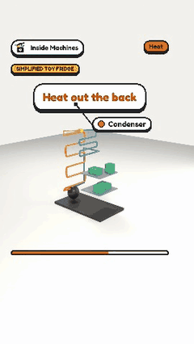</a><br><b>Inside a fridge</b><br><a href="https://www.youtube.com/shorts/LGQQ5k23KCk">Watch</a> · <a href="https://goinsidemachines.com/everyday/fridge/">Read</a></td>
<td align="center" width="33%"><a href="https://www.youtube.com/shorts/3ZuydOa6TxA">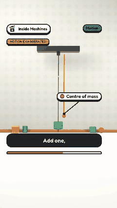</a><br><b>Big Ben's pennies</b><br><a href="https://www.youtube.com/shorts/3ZuydOa6TxA">Watch</a> · <a href="https://goinsidemachines.com/machines/the-great-clock/">Read</a></td>
<td align="center" width="33%"><a href="https://www.youtube.com/shorts/5y8AbpL8xd8">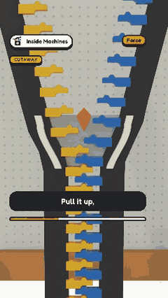</a><br><b>How a zipper locks</b><br><a href="https://www.youtube.com/shorts/5y8AbpL8xd8">Watch</a> · <a href="https://goinsidemachines.com/everyday/zipper/">Read</a></td>
</tr>
<tr>
<td align="center" width="33%"><a href="https://www.youtube.com/shorts/qe_AIuflBl4">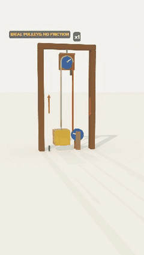</a><br><b>Pulleys</b><br><a href="https://www.youtube.com/shorts/qe_AIuflBl4">Watch</a> · <a href="https://goinsidemachines.com/machines/pulleys/">Read</a></td>
<td align="center" width="33%"><a href="https://www.youtube.com/shorts/PZWokxHSg_0">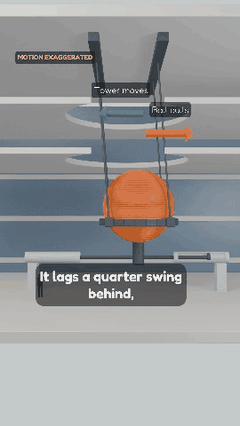</a><br><b>The Taipei 101 damper</b><br><a href="https://www.youtube.com/shorts/PZWokxHSg_0">Watch</a> · <a href="https://goinsidemachines.com/machines/the-taipei-101-damper/">Read</a></td>
<td align="center" width="33%"><a href="https://www.youtube.com/shorts/CiJkurEFW2g">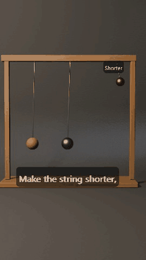</a><br><b>Heavy or light pendulum</b><br><a href="https://www.youtube.com/shorts/CiJkurEFW2g">Watch</a> · <a href="https://goinsidemachines.com/everyday/heavy-or-light-pendulum/">Read</a></td>
</tr>
</table>

<sub>Every short above was made by this plugin, end to end, with no hand editing: story, models, animation, voice,
captions, sound and edit. Click one to watch it with sound.</sub>

---

## What you get

- **A finished MP4**, 1080×1920 at 30 fps, with narration, captions timed to it, recorded sound effects and your own
  closing card. No music, ever.
- **A post pack**: title, description with sources, hashtags, a thumbnail you pick from candidates, SRT and VTT
  caption files (and translated ones, if you ask), and a before-you-post checklist.
- **One page per short** instead of chat walls: every stage, every approval, your notes and the review tools in one
  place, live while it works.
- **A real Blender project** you can open: `blend/short.blend`, built by a `build.py` you can read and change.
- **Checks you can trust**: the scene, the motion and every rendered frame are checked before you see anything.

## What's new in 0.5.0

- **[One page per short](#how-it-works)** with notes, approvals, a timeline, before and after, a fact panel and a
  voice check.
- **[Thumbnails, post pack and caption files](#9-post)**, including subtitles in other languages.
- **[Your brand](#your-brand)**: seven styles, four sets, cards drawn by the plugin, and a colour-blind check.
- **[Camera](#camera)**: `camera.follow`, one-take shorts where the picture sets the clock, and a quick grey camera
  test you can approve before anything renders.
- **[Faster checks](#checks-that-catch-what-youd-miss)**: the preview renders while the checks run, a re-check tests
  only what changed, and one run lists every overlapping pair, grouped.
- **[Make the next one faster](#make-the-next-one-faster)**: start from an earlier short, speak in paragraphs, and
  set your voice engine's own settings.
- **Fewer false alarms**: narrow tags for real designs (`fast`, `swap`, `rigid`, `assembly`, `volume`,
  `hero:s07@0.6`), and many fixes from real shorts.

## How it works

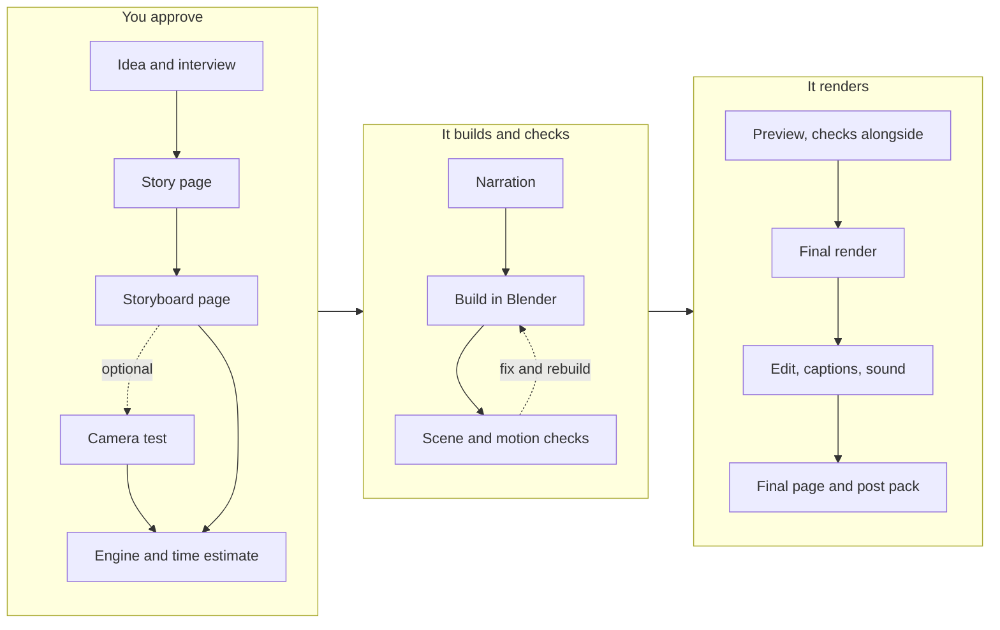

You talk to Claude Code as usual ("make a short about how a click pen clicks"). The `make-short` skill follows a
playbook chapter for every stage, tracks where each short stands, and picks up where it left off if you come back
tomorrow ("carry on with the pen short").

Everything shows on **one page per short**, served on your own computer. It updates while the plugin works, keeps
your notes on any line, shot or stage, and records each approval. Answer on the page or in chat.

### 1. Interview

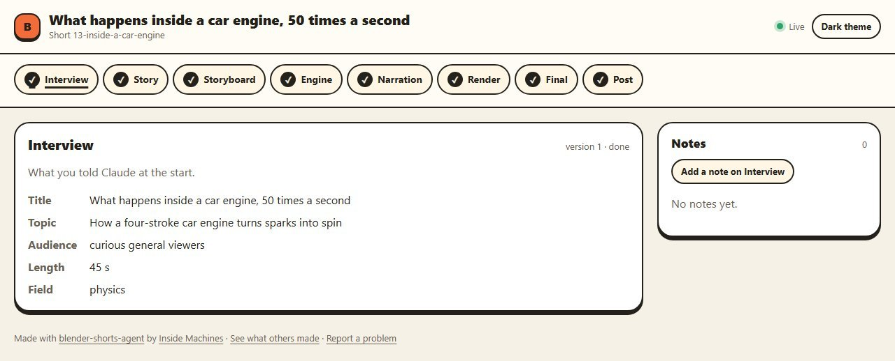

The topic, the length and the pace, your brand or a fresh look, and, if you started from an earlier short,
exactly what was copied, each with a button to change it.

### 2. Story

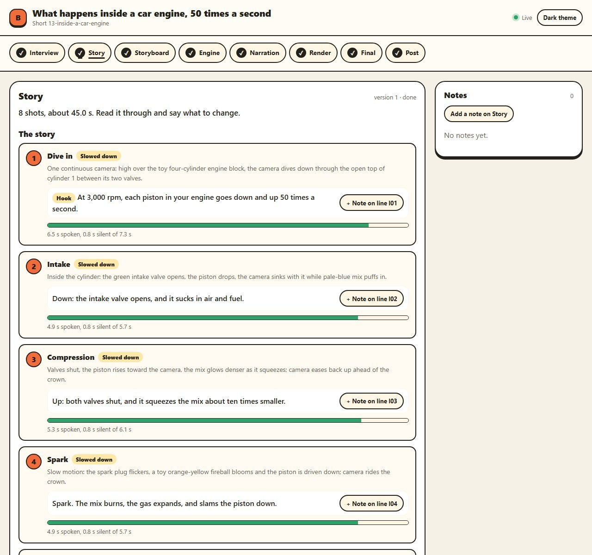

The hook, every beat with its narration line and how long it takes to say, honesty badges ("Simplified",
"Slowed down") wherever the picture bends reality, sources for every number, and how this short keeps each
of your hard rules.

### 3. Storyboard

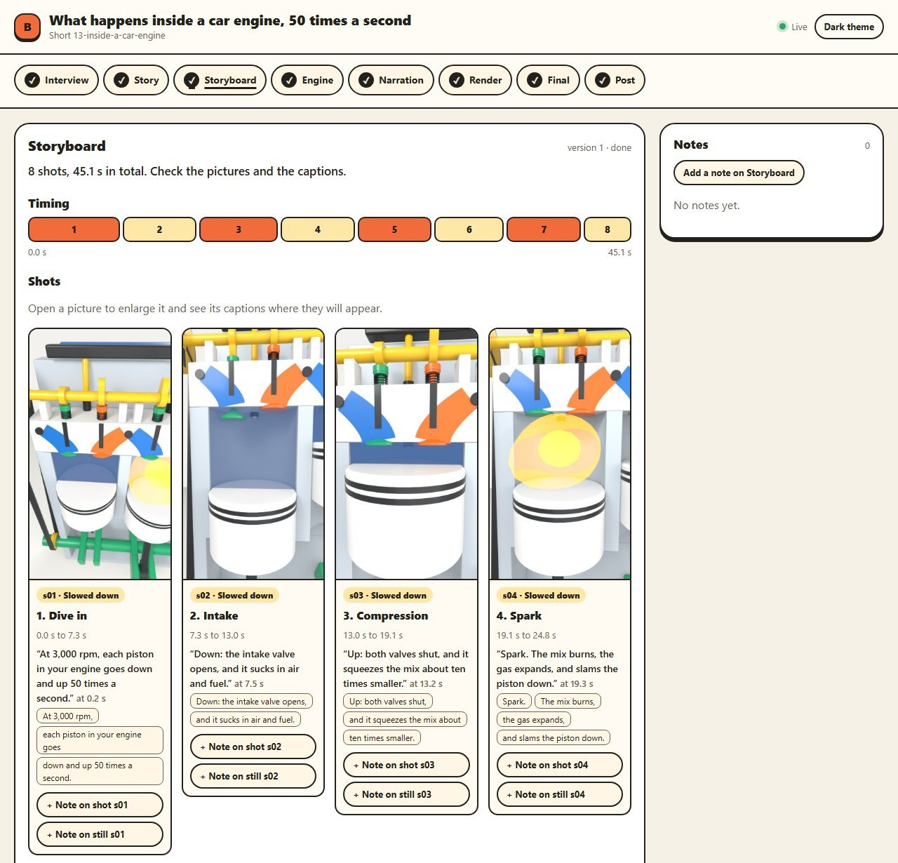

Each shot is built and rendered as a still before anything is animated, so you approve real pictures, not
descriptions. The look preview shows three stills with your cards, and the guides show where the captions and
top cards will sit.

### 4. Camera test (optional)

For shorts where the camera move is the star, `camtest` renders the whole move as a quick grey clip with a
contact sheet, and you approve the move before anything is rendered properly. It is always offered for
one-take shorts.

### 5. Engine

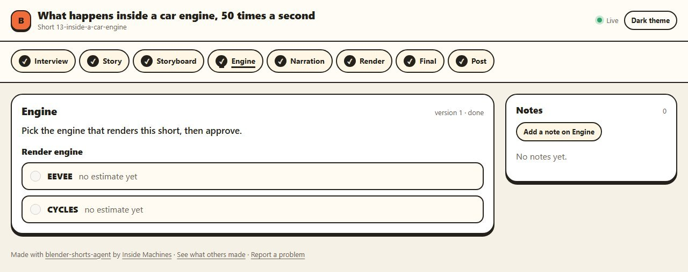

EEVEE or Cycles, with a time estimate for each from a real test frame. The choice is always yours.

### 6. Narration

Every line with its take, where its audio came from, and a voice check: what a speech recogniser heard, word by
word against the script, so a dropped or misread word stands out.

### 7. Render

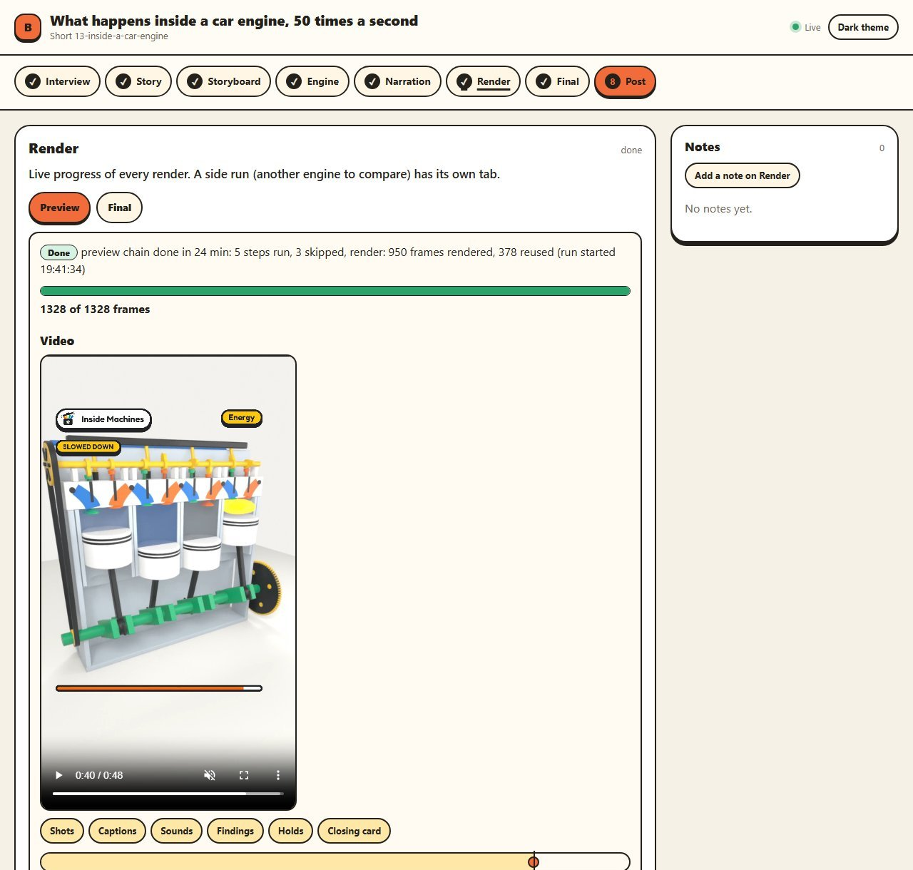

A live view of the whole chain (timeline, build, mix, checks, render, frame-check, edit): the current step,
frames done, time left, per-shot thumbnails and any warning as it appears. The checks run beside the preview
render, and only shots whose content changed render again.

### 8. Final

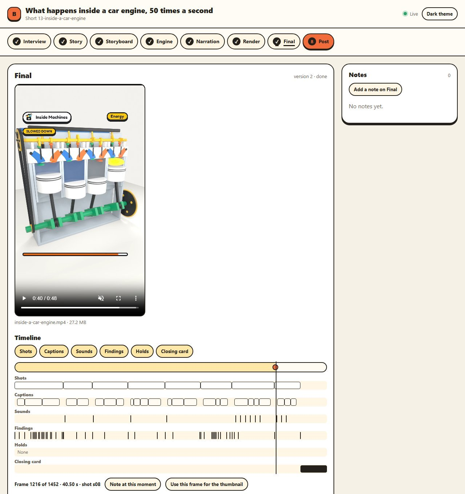

The video, a timeline of every shot and line, a before and after for anything you asked to change, and a
fact panel with each number and its source.

### 9. Post

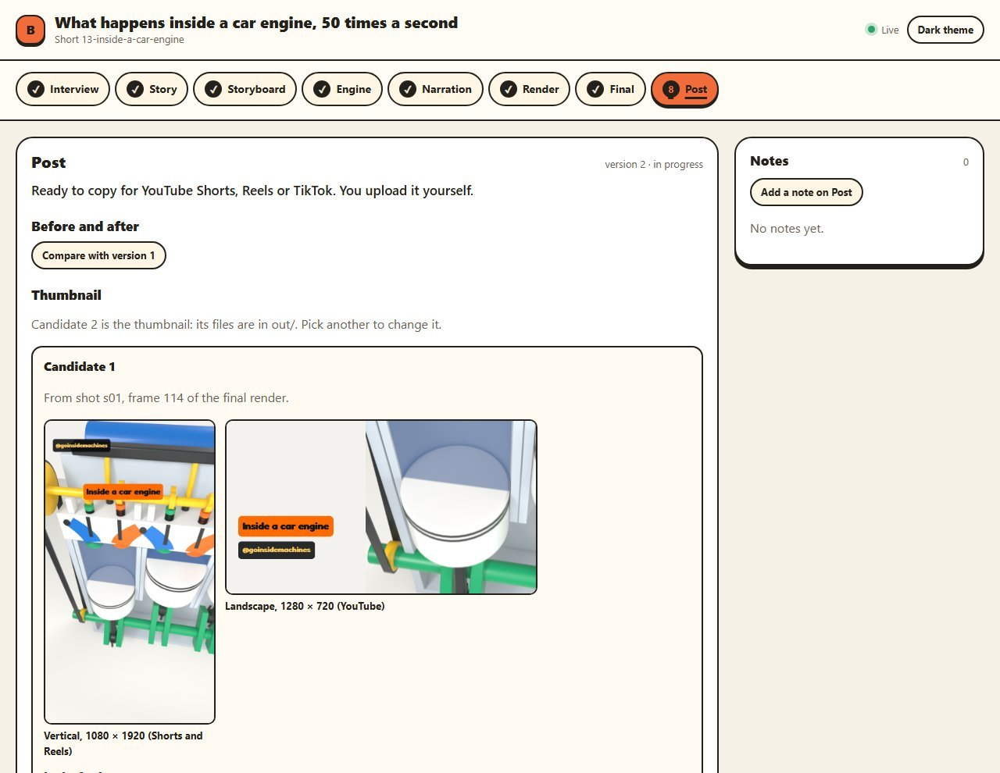

Thumbnail candidates to choose from, the post pack with copy buttons, the caption files (and any
translations), and a before-you-post checklist.

## Checks that catch what you'd miss

Explainer animation fails in small ways: a rod that passes through a bearing, a ball that floats a millimetre above
its cradle, two faces that flicker, a part that teleports for one frame. The plugin looks for all of it, on every
frame, before you see the video.

| In the scene | In the motion | In the rendered frames |
|---|---|---|
| Missing textures (pink), missing materials (grey) | Parts passing through each other, with depth and frames | Fireflies and noise |
| Flipped or inside-out normals, faceted curves | Pops: a part that jumps in one frame | Flicker between frames |
| Z-fighting faces, scaled to what the camera can see | Floating or sinking objects | Frames stuck when they should move |
| Live Booleans that can render differently | Heroes leaving the frame | Black frames |
| Names, tags and labels that point at the wrong object | Contact pairs whose parents drift apart | Colours off the planned look |

Every finding says what is wrong, where (object, shot, frame, position) and how to fix it, and the agent fixes it
itself and checks again. Single bad frames can be re-rendered on their own.

- **Fast:** the preview renders while the checks run in a second Blender, with a progress line per shot. A re-check
  after a fix tests only the objects and pairs that changed. Errors still block the final.
- **Every problem in one run:** overlapping pairs are grouped by name ("Tape left vs Tooth left 01-22: 22 pairs, up to
  1 cm, s01-s05"), real clips first, so you fix them all in one round.
- **No false alarms for real designs:** tag a part `fast` (a flick that really is that quick), `swap:<part>` (one part
  takes over from another in place), `rigid` (a part and its children are one solid), `assembly:<name>` (gears that
  mesh), `volume` (gas or flame), or `hero:s07@0.6` (a subject the camera reaches later). Each tag is checked, never
  just a mute: an assembly part that clips something outside its assembly is still an error.

**Extremes.** Before the preview, each moving part is rendered at full size at the ends of its motion, where things
usually collide:

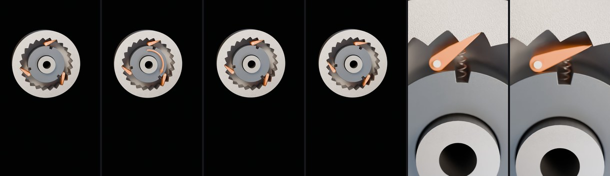

## Your hard rules

The first time you use it, the plugin asks for your own content rules, the things every video must keep whatever
the topic. For example: "No people on screen. No brand logos. Keep it family friendly." A broad rule can be spelled out in parts
in your own words. The rules are:

- shown on the story, storyboard and final pages, with how this short keeps each one;
- checked in the scene where they can be (object, material and model names), and in the sound (recorded sounds
  only, when you ask for that);
- never reinterpreted: if a request conflicts with one, the agent says so and asks.

You can add or change a rule any time, in plain words:

```
Add a hard rule: no humans, no people, body parts, faces, silhouettes or stick figures.
```

## Sound, voice and look

- **Narration** with a free local voice (Kokoro, Chatterbox or Chatterbox Turbo, installed only after you approve
  a list of what downloads, its licence and size), ElevenLabs with your own key, or **your own voice tool** through
  one command. Any voice problem means captions only, and the short goes on.
- **Sound effects** from recorded CC0 packs (OpenGameArt, Kenney, Wikimedia Commons, Freesound with a key), placed
  on the moments your simulation reports. Designed UI sounds are kept out of a natural-sounds-only mix.
- **Captions** timed to the narration, kept clear of the platform's buttons, and checked for missing glyphs.
- **Your brand or a fresh look per short**: your colours, fonts, handle and end card, or a new style chosen on the
  story page.
- **A closing card**: set your website (and, if you like, your own 1080x1920 image and a line for the narrator) and
  every short ends on it for a few seconds, the line read over it, so viewers who can't tap a link still see and hear
  where to go. Without an image the plugin makes one from your brand. No music or sound is added.
- **Honesty**: every number on screen or in the narration has a source; exaggerated or slowed motion carries a badge;
  myths are cut.

## Your brand

A **brand kit** is your colours, fonts, handle, end card, a look and a set, saved once and used by every short. Say
"set up my brand" and the plugin shows a sample sheet of the kit before it saves anything.

- **Seven styles**: realistic, toy, toon, clay, blueprint, paper and pencil, each built from your palette. With none
  chosen, shorts look as they always did.
- **Four sets** for the scene around the machine: workbench, graph, outdoor and studio (or none), picked per short or
  fixed in the kit.
- **See it first**: the storyboard page carries a look preview (three stills with your cards, plus the kit sheet), and
  `style-sample` tiles any styles on any set.
- **Your engine, your choice**: EEVEE or Cycles is always yours to pick; every style looks right in both. These
  samples were rendered with EEVEE.

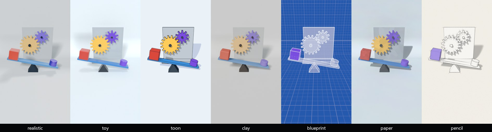
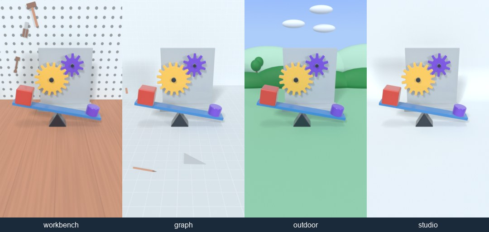

## Camera

Every camera style is your choice, short by short:

- **Cuts** (the default): each shot is its own shot, and each can be static, a move or orbit, or a follow.
- **`camera.follow`**: track a moving part (the camera turns to keep it in the frame) or ride it (the camera moves
  with it), smoothed and kept clear of the captions.
- **One take**: one continuous move, where each shot is a fixed window on the camera path and its lines are placed
  inside it. The narration never changes the move; a line too long for its window says by how much.
- **`camtest`**: a quick grey fly-through and contact sheet to approve the move first. It never changes your render
  settings.

## Make the next one faster

- **Make it like that one**: `new-short --like 09` starts from an earlier short's look, pace, closing and voice. Only
  the subject, story and facts are new, and the page shows exactly what was copied.
- **Paragraph takes**: the voice speaks a paragraph at a time and the plugin cuts it back into lines, so lines flow
  instead of starting cold. A lead-in gives every line the same breath before its first word.
- **Your voice engine's own settings** (`narrator.params`) for the local voices.
- **Machinery sounds**: two CC0 packs with steam hiss, machine rumble and impacts, offered with their size before
  anything downloads.
- **Move your workspace** with `CLI workspace move NEW`: it refuses while anything is running, fixes every stored
  path, and never deletes the old folder.

## Built for real machines

The playbook has a physics chapter and helpers for mechanisms, structures, forces and motion: pendulums, contact
chains (Newton's cradle), ratchets, levers, dampers. Motion is solved or simulated and baked, not keyframed by eye, so
the balls in the cradle trade momentum the way real ones do. It also covers cutaway (section) models, gear trains
and engines (rigid assemblies), and time warps that keep sounds on the real beats.

## Guidelines for a good short

What the playbook steers every short towards:

- **Hook in the first three seconds**: a question or a surprise, not a title card.
- **One idea per beat**, and each idea lands on its picture: say "the pawl drops in" while the pawl drops in.
- **Captions carry the story with the sound off.**
- **Fast pace**: a shot runs about as long as its line plus a breath.
- **Honest pictures**: every number has a source, slowed or exaggerated motion carries a badge, myths are cut.
- **Approve stills before motion**, and a camera move before a long render.
- **A closing line that lands**, over your own closing card.

## Install

You need [Claude Code](https://claude.com/claude-code) and [Blender](https://www.blender.org/download/) 4.5 or newer.
An NVIDIA GPU makes Cycles and the local voices much faster, but EEVEE and Kokoro run on any computer.

In Claude Code:

```
/plugin marketplace add goinsidemachines/blender-shorts-agent
/plugin install blender-shorts-agent@blender-shorts-agent
```

Then just ask:

```
Make a short about why a bike wheel ticks when you stop pedalling.
```

The first run asks a few questions (where to save shorts, which voice, your render preference, brand or fresh look,
your hard rules, your handle) and remembers the answers.

**Staying up to date.** Plugins from a marketplace like this one don't update by themselves unless you turn it on
once: run `/plugin`, open the **Marketplaces** tab, pick **blender-shorts-agent** and choose **Enable auto-update**.
Claude Code then fetches each new release in the background and tells you to run `/reload-plugins`. Or update by
hand whenever a [new release](https://github.com/goinsidemachines/blender-shorts-agent/releases) comes out:

```
/plugin update blender-shorts-agent@blender-shorts-agent
```

After updating to 0.5.0 with a local voice, run `CLI voice install <voice>` once so the voice runner knows the new
settings.

**Script mode or MCP mode.** By default the plugin drives Blender in the background from the command line. If you
use the [Blender MCP](docs/mcp-setup.md) add-on, it can build in your open Blender instead, so you watch the scene
come together.

## What it runs and connects to

Everything runs on your own computer. The plugin sends no telemetry and has no server of its own.

- **What it runs:** Python scripts in this repository, with Blender in the background (or your open Blender through
  the Blender MCP add-on), and your own voice command if you set one.
- **What it fetches, only after you approve a list of what, from where, its licence and its size:** sound effects
  from OpenGameArt, Wikimedia Commons and Freesound (with your own Freesound key); textures, HDRIs and models from
  Poly Haven; fonts from Google Fonts; and, for the optional local voices, model weights from Hugging Face and Python
  packages through [uv](https://docs.astral.sh/uv/).
- **What it sends:** search words to those asset sources, and, only if you choose ElevenLabs for narration, your
  narration lines to ElevenLabs with your own API key.
- **Plugin feedback:** when the plugin gets something wrong, Claude notes it in the short's folder. Only if you
  choose, it opens a prefilled GitHub issue for you to review and submit yourself. Nothing is sent otherwise.
- **What it keeps:** your settings in `~/.blender-shorts-agent/` (workspace, voice, hard rules, handle) and each
  short in its own folder in your workspace. Nothing leaves your machine besides the requests above.

## Under the hood

- `skills/make-short/`: the skill and its playbook, one chapter per stage, plus craft, honesty, sound, look and
  physics chapters.
- `bsa/`: the Python package that runs inside Blender's own Python (standard library and numpy only): scene helpers,
  checks, timeline, captions, audio mix, review pages.
- `bsa_cli.py` (plain Python) and `bsa_blender.py` (inside Blender): the commands the agent runs. Each prints one
  JSON result.
- `voices/`: the optional local voice runner.

```
uv run pytest        # 2,000+ tests, including Blender scene tests
uv run ruff check .
```

## Community

- **Made a short with it?** Post it in [Show and tell](https://github.com/goinsidemachines/blender-shorts-agent/discussions/categories/show-and-tell).
- **Questions and ideas:** [Discussions](https://github.com/goinsidemachines/blender-shorts-agent/discussions).
- **Bugs:** [Issues](https://github.com/goinsidemachines/blender-shorts-agent/issues), using the bug report form.
- **Security problems:** report them privately, as [SECURITY.md](SECURITY.md) explains.
- **Contributing:** see [CONTRIBUTING.md](CONTRIBUTING.md) and the [code of conduct](CODE_OF_CONDUCT.md).

## Licence

MIT. Sound packs, fonts, textures and voices the plugin downloads keep their own licences, which are shown before
anything is downloaded.

---

Made by Inside Machines, a studio of Mojood.
